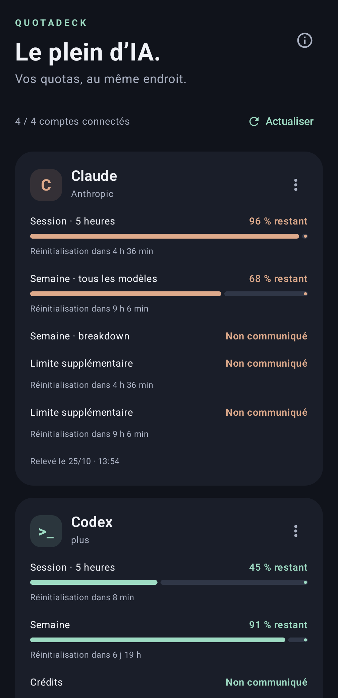
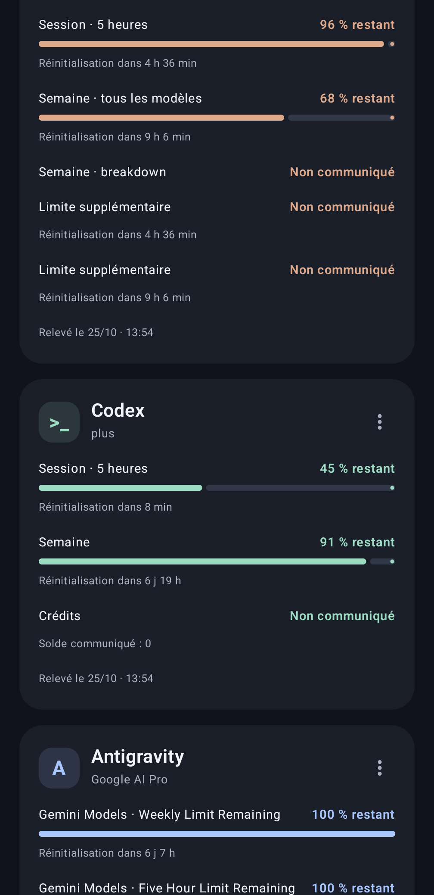

# QuotaDeck

Subscription quotas for **Claude, Codex, Google Antigravity and OpenCode Go**, with independent native clients in one repository. App-owned UI and documentation are in English. No remote QuotaDeck backend, ads, telemetry, purchases or AI generation requests.

## Clients

- **[Android](clients/android/README.md)** — working Kotlin / Jetpack Compose client, Android 8.0+. [Download v0.1.5](https://github.com/juliendevelopment/quota-deck/releases/tag/v0.1.5). Install updates **over the existing app without uninstalling** to keep encrypted sessions.
- **[GNOME Shell extension](clients/gnome-extension/README.md)** — next implementation phase. Its directory and feature-parity scope are prepared; this repository reorganization does **not** yet ship an installable extension.

The GNOME client is intended to expose the same providers, quota information and connection/account configuration, using GNOME-native UI and secure desktop storage. Each client connects directly to providers and owns its local sessions; accounts are not automatically synchronized between devices.

## Repository layout

```text
clients/
  android/                 # Complete Android project, Gradle wrapper, tests and signing script
    app/
    gradle/
    scripts/build_signed.py
    README.md
    RELEASE_NOTES.md
  gnome-extension/         # GNOME client boundary and implementation brief
shared/                    # Cross-client behavior/data contract, not a runtime or server
  README.md
docs/
  architecture.md          # Ownership, security boundaries and release conventions
  screenshots/
tests/                     # SDK-free repository/CI-path/link checks
.github/workflows/         # Root workflows with client-specific working directories
```

The Android move preserves the application ID, encrypted storage, OAuth configuration, source code, signing key and version. Existing release tags and download URLs are unchanged. No new Android version is published solely for this directory move.

## Android preview

<p align="center">
  
  
</p>

Real Compose rendering with **synthetic test fixtures**, not live account quota readings. These illustrate the existing Android client, not an implemented GNOME extension.

## Development

Repository checks need only Python's standard library:

```sh
python3 -m unittest discover -s tests -v
```

Android commands run from the Android client, **not the repository root**:

```sh
cd clients/android
./gradlew testDebugUnitTest lintDebug assembleDebug --no-daemon
```

Use JDK 17, SDK 35 and build-tools 35.0.0. See the [Android guide](clients/android/README.md) for connection flows, security, troubleshooting and signing. To call the self-locating signing script from the repository root:

```sh
python3 clients/android/scripts/build_signed.py --config /private/path/signing.json
```

[Android CI](.github/workflows/build.yml) checks the repository, then tests/lints/builds Android from `clients/android`. [Signed Android Release](.github/workflows/release.yml) keeps the existing `vMAJOR.MINOR.PATCH` tag convention and reads client-local release notes. GNOME will have its own tests, package and release convention; it must not depend on Android's toolchain.

## Shared behavior and security

Read the [cross-client contract](shared/README.md) and [architecture](docs/architecture.md) before adding a client. Both clients must preserve missing quotas as unknown, retain and mark stale readings on refresh failure, use official browser consent instead of embedded Google SSO, and expose safe diagnostics. They must never generate model calls to discover limits, create cloud projects, activate billing or silently import another application's credentials.

Provider quota interfaces and public installed-client OAuth integrations are unofficial and can change or reject access. A fixture test or package build does not prove that a real account can authorize or return quota data. Consent stays on the user's device; never send passwords, API keys, device codes, cookies or tokens through chat.
